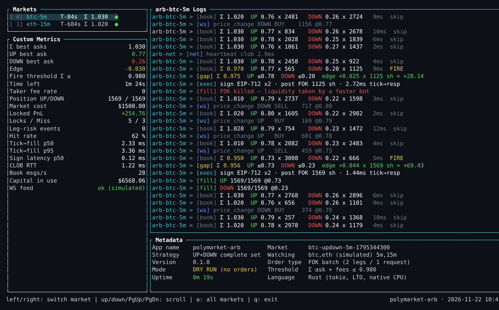

# polymarket-arb — bot arbitrase UP/DOWN Polymarket (Rust)

Bot latensi rendah yang memantau pasar crypto **Up or Down** (BTC/ETH/SOL/XRP 5m & 15m) dan
**membeli UP dan DOWN sekaligus** ketika `ask UP + ask DOWN + fee taker ≤ 0.98`.
Karena salah satu sisi pasti dibayar $1/share, selisihnya adalah profit yang terkunci
apa pun hasil pasarnya.



## Kenapa Rust (bukan C++)
Kecepatan Rust dan C++ setara (sama-sama dikompilasi native, tanpa GC). Rust dipilih karena:
SDK resmi Polymarket tersedia untuk Rust (`polymarket_client_sdk_v2`), jadi format order
EIP-712 V2 dijamin benar; dan memory-safety mencegah crash di tengah trading.
**Bottleneck sebenarnya adalah jaringan** (jarak server kamu ke server Polymarket), bukan bahasa.

## Optimasi kecepatan
- Orderbook array datar (indeks = harga dalam 0.0001), update O(1), tanpa alokasi.
- Parsing JSON WebSocket zero-copy, harga langsung jadi integer.
- Semua cache (tick size, neg-risk, fee, versi protokol) dipanaskan saat market ditemukan →
  jalur tembak **tidak ada request jaringan selain POST order**.
- **Dua kaki dikirim dalam SATU request** `POST /orders` (batch), sign keduanya paralel (~0.1 ms).
- Header HMAC L2 dihitung sendiri; tidak menunggu polling tx-hash 30 detik seperti SDK.
- Koneksi HTTP/2 ke CLOB selalu "hangat" (keepalive tiap 5 dtk), TCP_NODELAY, mimalloc,
  build `lto=fat`, `codegen-units=1`, `target-cpu=native`.
- Pasar jendela berikutnya sudah di-subscribe sebelum dibuka.

## Penanganan risiko
- Order **FOK** (isi penuh atau batal) untuk kedua kaki.
- Jika hanya satu kaki yang terisi: coba lengkapi kaki lain selama total ≤ `RECOVERY_MAX_PAIR_COST`
  (default 1.00 = impas); jika gagal, jual kembali kelebihannya dengan rugi maks
  `UNWIND_MAX_LOSS_PER_SHARE`. Sisa yang tidak bisa ditutup ditandai `ALERT` di log.
- Batas modal per trade / per market / total, berhenti `STOP_BEFORE_END_SECS` sebelum jendela tutup.
- Cek geoblock saat start — bot menolak jalan jika IP diblokir Polymarket.
- `DRY_RUN=true` secara default.

## Cara pakai
```bash
# 1. Install Rust: https://rustup.rs
# 2. Coba tampilannya dulu (simulasi, tanpa wallet):
cargo run --release -- --demo
# 3. Konfigurasi:
cp .env.example .env   # isi POLYMARKET_PRIVATE_KEY, SIGNATURE_TYPE, dll
# 4. Jalankan (DRY_RUN=true dulu, amati beberapa jam):
cargo run --release
# Tanpa TUI (untuk systemd/docker):
cargo run --release -- --no-tui
```
Kontrol TUI: `←/→` ganti market, `↑/↓/PgUp/PgDn` scroll log, `a` semua market, `q` keluar.
Saat TUI aktif, log lengkap ditulis ke `polymarket-arb.log`.

Syarat wallet: saldo USDC di Polymarket dan allowance sudah di-approve (otomatis jika pernah
trading lewat polymarket.com). Setelah market selesai, **redeem** posisi menang di polymarket.com
(bot tidak melakukan redeem/merge on-chain).

## Hal yang perlu diketahui (jujur)
- **Tidak ada bot yang dijamin selalu menang** melawan bot lain. Peluang Σ < 0.98 di pasar
  likuid jarang dan hilang dalam milidetik; pemenangnya biasanya yang servernya paling dekat.
  Jalankan di VPS sedekat mungkin dengan server CLOB Polymarket dan lihat angka `CLOB RTT`
  di dashboard (target < 5 ms). Build di VPS itu juga (karena `target-cpu=native`).
- Pasar crypto Up/Down mengenakan **fee taker**; bot sudah memasukkannya ke perhitungan
  (`rate × (p(1−p))^exponent`, dibaca otomatis per market).
- Bot sudah dikompilasi & unit-test-nya lolos (math arbitrase, orderbook, HMAC dengan
  vektor uji resmi SDK, parsing pesan WS), tetapi **belum diuji ke server Polymarket live**.
  Mulai dengan `DRY_RUN=true` lalu modal kecil.
- Pastikan penggunaan Polymarket legal di negara kamu dan sesuai Terms of Service.
